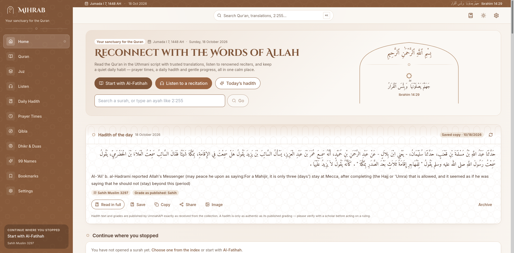
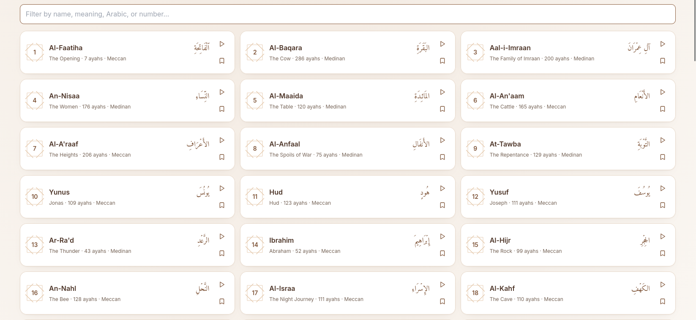
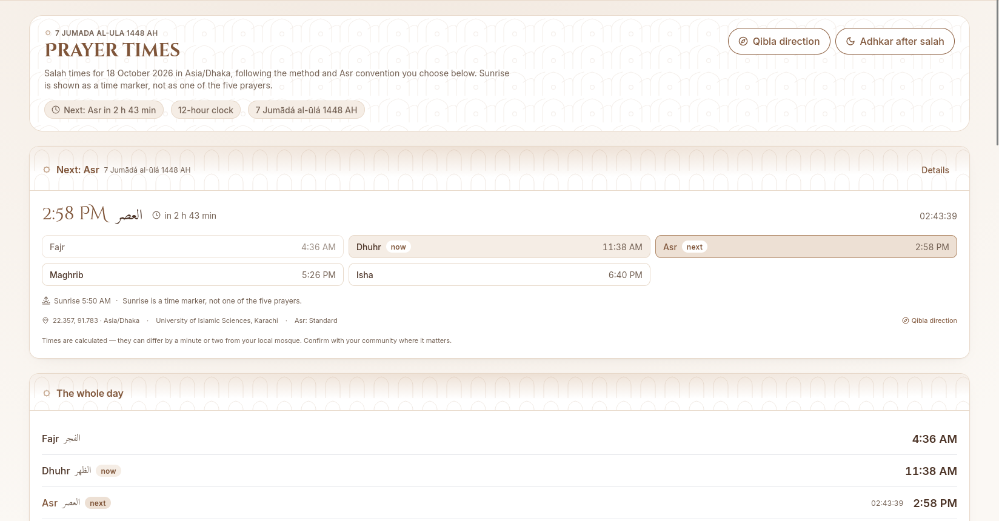
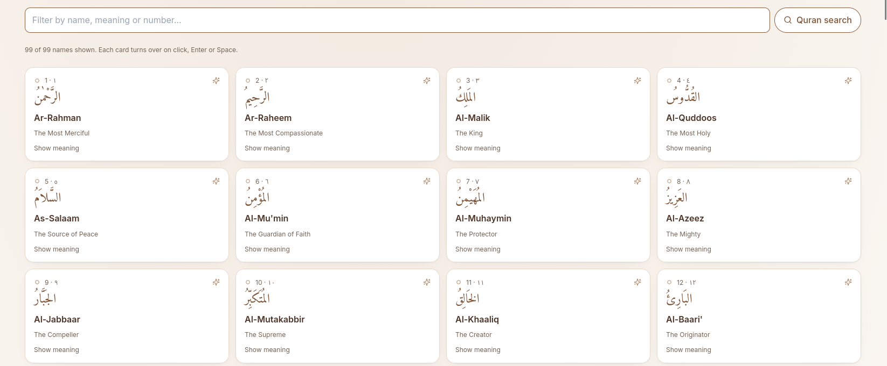
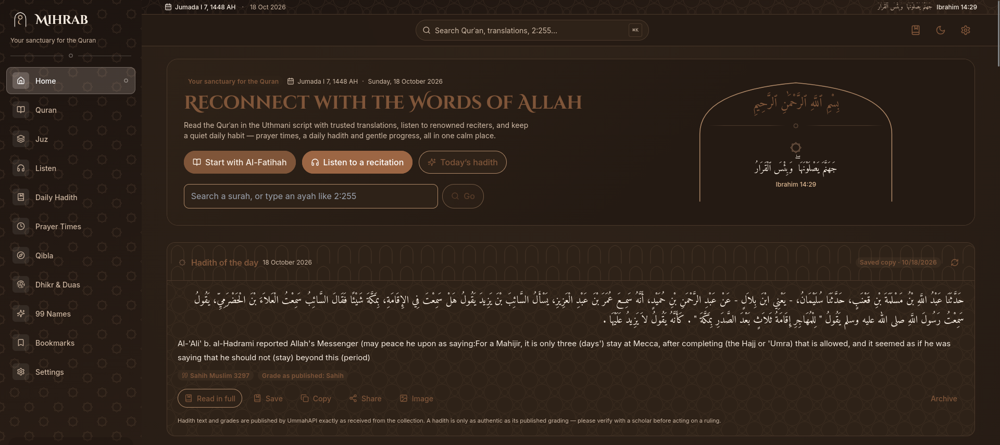

# Mihrab: Your Sanctuary for the Quran

A calm, light-themed Islamic web app for reading and listening to the Quran, with a daily Hadith, prayer times and more. It is free, has no ads, no accounts and no tracking.

**Live site: [mihrab.ajanik.dev](https://mihrab.ajanik.dev)**

## Features

**Quran**
- All 114 surahs in the Uthmani script, with a trusted translation under each ayah
- English and Bengali translations, with optional transliteration
- Browse by surah or by Juz, and search by name, number or text (for example `2:255`)
- Adjustable Arabic font size, line spacing and reading width
- "Continue where you stopped" remembers your last position

**Recitation**
- Verified recitations from named reciters, with a reciter selector
- Play any ayah and continue through the surah ("play from here"), or play a single ayah
- Repeat the surah or the ayah, autoplay the next surah and a sleep timer
- Persistent mini-player that keeps playing while you browse
- Recitation always plays at its natural pace

**Daily Hadith**
- One Hadith per day that stays the same all day and changes at local midnight
- A once-a-day popup, plus an archive of previously shown Hadith
- Collection, number and published grade are always shown with the source

**Prayer times**
- Fajr, Sunrise, Dhuhr, Asr, Maghrib and Isha for your location
- A large live countdown to the next prayer and the current prayer window
- Forbidden (makruh) times for voluntary prayer, with adjustable offsets
- Qibla direction and the Hijri date

**More**
- Dhikr and duas, a tasbih counter and the 99 Names of Allah
- Daily reading goal with a gentle streak
- English and Bangla interface (বাংলা)
- Light theme by default, with an optional soft dark mode for night reading
- Installable as a PWA, and responsive on mobile, tablet and desktop

## Screenshots

| All 114 surahs | Prayer times |
|---|---|
|  |  |

| 99 Names of Allah | Dark mode (optional) |
|---|---|
|  |  |

## Built with

React, TypeScript, Vite, Tailwind CSS, TanStack Query and Vitest. Deployed on Vercel.

## Content sources

Mihrab does not write or generate any religious content. Everything is published by the services below and shown with its source:

- Quran text, translations and search: [AlQuran Cloud](https://alquran.cloud)
- Recitations: [Islamic Network](https://islamic.network) and [MP3Quran](https://mp3quran.net)
- Hadith, duas, names and Hijri dates: [UmmahAPI](https://ummahapi.com)
- Prayer times: [AlAdhan](https://aladhan.com)

## Important notes

- Hadith text and grades are shown exactly as published by the source. A Hadith is only as authentic as its published grading, so please verify with a scholar before acting on a ruling.
- Prayer times and forbidden times are calculated from the sun's position and can differ by a minute or two from your local mosque's timetable. Follow your local community where it matters.
- Hijri dates are calculated and may differ by a day from local moon sighting.
- Adhkar and the 99 Names are pending scholarly review.

## About the developer

**Kazi Abu Jafar Anik**, student at International Islamic University Chittagong.

- Website: [ajanik.dev](https://ajanik.dev)
- GitHub: [@Aj-Anik](https://github.com/Aj-Anik)

Feedback and corrections are welcome. Please open an issue in this repository.

## License

Copyright (c) 2026 Kazi Abu Jafar Anik. All rights reserved. The source code is private.
